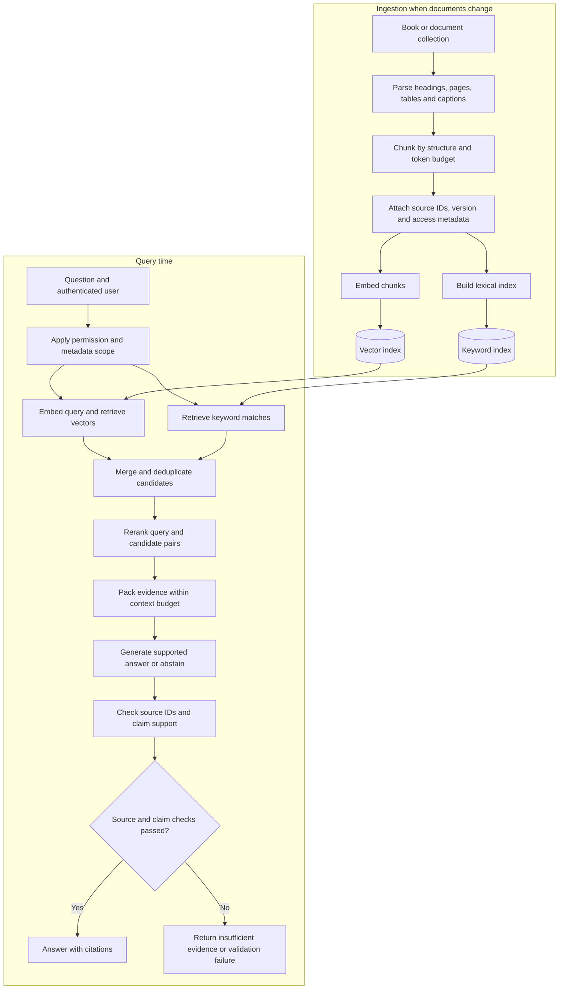
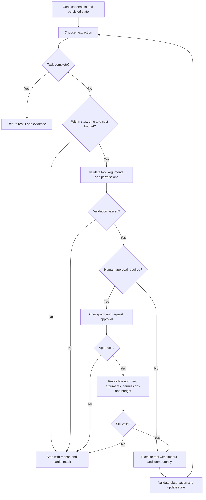
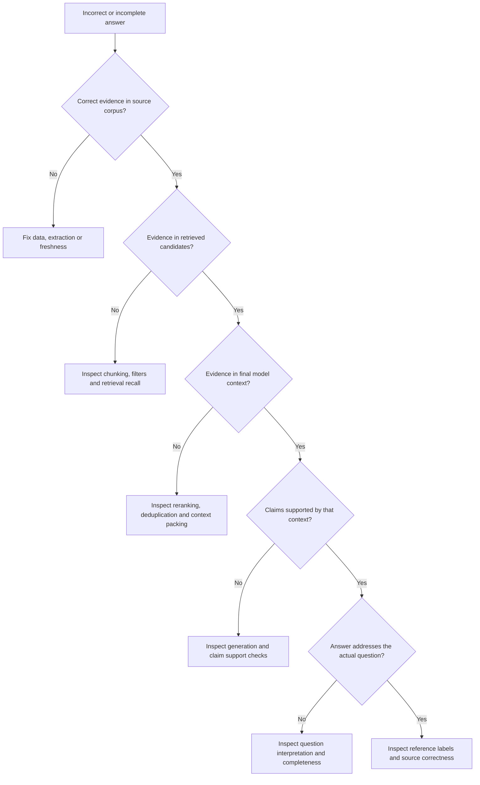
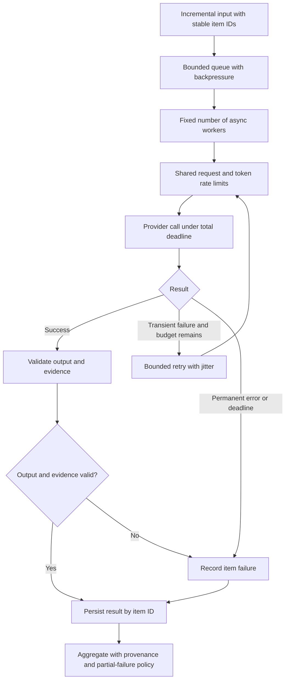

# AI Solution Engineering: repository review and learning maps

Reviewed 7 September 2026. This is a preparation plan based on the current checkout and the requested topics. The pasted “tomorrow, 4 Sep” date is historical. The actual invite was not independently inspected.

Start with the [50-question guide](/Users/nklars0/Projects/int-ai-m/notes/ai-solution-engineering-top-50.md). It includes short spoken answers, follow-up traps, four coding drills, and a 90-minute mock. The order is a preparation recommendation, not a prediction of the interview questions.

## Main recommendation

Turn the existing Practice features into a focused rehearsal path: understand a diagram, explain a decision, answer a changed constraint, and implement one small part. More general question volume is a lower priority than accurate material and trustworthy feedback.

The production loader returned **956 distinct questions in 14 packs**. The AI Engineer role selects **585 questions across 11 groups**, including broad Python, AWS, DevOps, classical ML, and interview-prep material. Active Recall, Voice Rehearsal, Interview mode, help tracking, weak-topic practice, and target-date review scheduling already exist. Preserve those features. See the [role definition](/Users/nklars0/Projects/int-ai-m/Domain/Practice/PracticeLogic.swift:273), [adaptive scheduling](/Users/nklars0/Projects/int-ai-m/Domain/Practice/PracticeLogic.swift:650), and [verified loader output](/Users/nklars0/Projects/int-ai-m/.codex-loop/ai-prep-audit-20260907/coverage-probe.log).

## Improvements in implementation order

| Priority | Verified gap | Concrete change | Acceptance evidence |
| --- | --- | --- | --- |
| 1 | The Recall@k answer describes the fraction of questions with a hit. | Correct answer, rubric, and hints together; distinguish Recall@k, Hit@k, Precision@k, and MRR with a multi-evidence example. | Two relevant documents with only one retrieved produces recall 0.5 and hit 1; no-hit and ranking-change cases agree with definitions. |
| 2 | Active Recall accepts a contradictory statement as covered; judge failure can become a heuristic score. | Label keyword matches as provisional coverage. Store grading provenance; exclude unavailable/fallback grading from mastery. Add explicit expected concepts and prohibited misconceptions. | Contradictions do not earn verified mastery; malformed judge responses and network failures remain ungraded; an accurate paraphrase still receives credit. |
| 3 | The AI role selects 585 broadly distributed questions. | Add an AI Solution Engineering preset of 50 curated questions, reusing existing IDs where suitable. Include priority and concept links; use the existing Practice tab. | Exact stable selection, intended topic distribution, no duplicate IDs; existing progress remains associated with existing questions. |
| 4 | The practice model has no scenario dependencies or executable exercise specification. | Link design questions to follow-ups and add timed coding drills with supplied local fakes and assertions. | One question at a time; follow-ups change constraints; code is run against meaningful cases; help-assisted attempts remain distinguishable. |
| 5 | Existing charts do not teach system structure. | Attach the learning maps below to relevant questions, with a “draw/explain from memory” attempt before revealing the reference. | The learner can explain each stage, one failure mode, and one tradeoff without Help. |
| 6 | Some processor tests copy implementation logic. | Extract small pure production policies and test those exact files; add a reviewed interview evaluation set. | A deliberate change to a production detection/formatting policy fails its test; provider failures are recorded separately from answer quality. |
| 7 | Conversation summarization can run only once; retained history grows afterward. | Refresh a rolling summary using a summarized-through-turn boundary and a bounded recent window. | Long synthetic conversations preserve active constraints and answer late follow-ups without duplicating already summarized turns. |

Evidence for these changes:

- **Metric defect:** [LLM bank answer](/Users/nklars0/Projects/int-ai-m/Resources/practice/llm-interview.json:671). “A relevant result exists” equals recall only when each query has exactly one relevant item. The [Stanford IR text](https://nlp.stanford.edu/IR-book/html/htmledition/evaluation-of-unranked-retrieval-sets-1.html) defines recall using all relevant items as the denominator.
- **Grading defect:** [word-overlap function](/Users/nklars0/Projects/int-ai-m/Domain/Practice/PracticeLogic.swift:807) and [discarded negation](/Users/nklars0/Projects/int-ai-m/Domain/Practice/PracticeLogic.swift:783). An offline probe compiled the real production functions: “RAG does not retrieve external context.” was marked as covering “RAG retrieves external context.” See [probe evidence](/Users/nklars0/Projects/int-ai-m/.codex-loop/ai-prep-audit-20260907/coverage-probe.log). [Malformed-judge fallback](/Users/nklars0/Projects/int-ai-m/Infrastructure/Practice/PracticeGroqClient.swift:82) also needs explicit provenance.
- **Preset and drill seams:** [question model](/Users/nklars0/Projects/int-ai-m/Domain/Practice/PracticeLogic.swift:39), [role selection](/Users/nklars0/Projects/int-ai-m/Domain/Practice/PracticeLogic.swift:273), and [existing question-count control](/Users/nklars0/Projects/int-ai-m/Presentation/Practice/PracticeTabController.swift:377). The AI role does not include the generic `coding-tasks` group; current FastAPI questions are oral design material.
- **Test boundary:** [test file declaration](/Users/nklars0/Projects/int-ai-m/Tests/test_processor.swift:3) and [compiler inputs](/Users/nklars0/Projects/int-ai-m/Tests/test.sh:6). Practice tests do compile production Practice logic; the copying issue does not apply to every test.
- **Long-session behavior:** [summary trigger](/Users/nklars0/Projects/int-ai-m/Domain/Model/ConversationContext.swift:192) and [post-summary message selection](/Users/nklars0/Projects/int-ai-m/Domain/Model/ConversationContext.swift:245). This is a code-level risk, not a measured 90-minute runtime failure.

Two additional prompt corrections are worthwhile: [RAG/CAG formatting](/Users/nklars0/Projects/int-ai-m/Infrastructure/Speech/GroqInterviewClient.swift:335) forces a RAG definition even for a CAG-only topic, and the [fallback experience prompt](/Users/nklars0/Projects/int-ai-m/Infrastructure/API/AnthropicClient.swift:343) supplies “8+ years” as an example. Separate concept-specific answer shapes and make personal claims depend only on actual user-provided experience. Keep teaching explanations in Practice; brief voice cues have a different purpose.

## Map 1: explain RAG using two separate flows

Rehearse: “I separate ingestion from query handling. Ingestion preserves structure and provenance. Retrieval finds candidate evidence, reranking orders that evidence for this query, and the model writes from the selected context. I evaluate each stage separately.”

The important contrast is **broad candidate retrieval versus precise final evidence selection**. Hybrid search combines lexical and vector retrieval; Azure AI Search uses reciprocal rank fusion to merge them. A reranker acts on the candidate set, so it cannot restore a passage missing from that set. See [hybrid retrieval](https://learn.microsoft.com/en-us/azure/search/hybrid-search-overview) and [semantic reranking](https://learn.microsoft.com/en-us/azure/search/semantic-search-overview).

Practice the changed constraints:

- **Whole book:** preserve chapters and page provenance; retrieve specific passages for facts and consider chapter-level summaries for broad questions. A universal chunk size is not a defensible answer—choose an initial baseline and compare retrieval quality and context cost.
- **Tables:** preserve row/column labels, units, captions, and page links; use structured computation when the answer requires arithmetic.
- **Multi-hop:** break the question into evidence needs, retrieve each, and check that all required links are supported. Finding one good passage does not establish complete evidence.
- **GraphRAG:** explain the added entity/relationship or community-summary index, the type of queries it helps, and its indexing and maintenance cost. Microsoft's GraphRAG uses graph extraction and hierarchical community summaries; merely doing two vector searches is not that architecture. See [GraphRAG documentation](https://microsoft.github.io/graphrag/).

## Map 2: a bounded agent with approval before side effects

Rehearse: “The model proposes actions; application code controls what can execute. I keep explicit state, validate arguments and results, bound the loop, and pause before actions that need approval.”

For LangGraph, explain nodes, conditional edges, state reducers, and checkpointing before reaching for API trivia. An interrupt needs persistent state and a stable thread identity to resume. Code before an interrupt may run again, so side effects need careful placement and idempotency. See [LangGraph interrupts](https://docs.langchain.com/oss/python/langgraph/interrupts).

Follow-ups: “What survives a crash?”, “What if two branches update the same state key?”, “What prevents duplicate tool writes?”, and “Would a fixed workflow solve this more simply?”

## Map 3: diagnose a wrong answer before changing the model

Rehearse: “I trace a failure through the corpus, retrieval candidates, final prompt, and generated claims. Each has a different fix.” Faithfulness measures support in the supplied context; it does not prove the source itself is correct. See [Ragas faithfulness](https://docs.ragas.io/en/stable/concepts/metrics/available_metrics/faithfulness/).

Use this hand calculation before any evaluator library: there are four relevant chunks and the first three results are irrelevant, A, irrelevant. Precision@3 is **1/3**, Recall@3 is **1/4**, Hit@3 is **1**, and reciprocal rank at 3 is **1/2**. MRR is the mean reciprocal rank across queries. Moving A to rank 1 improves reciprocal rank but does not recover the other three pieces of evidence. Evaluate multi-hop completeness separately. With no relevant items in the gold set, define a separate unanswerable-query policy instead of dividing by zero.

## Map 4: process 10,000 items without flooding the provider

Rehearse: “I bound queued work, concurrent calls, and provider rate separately. Every item has an identity, a deadline, and a persisted outcome. I can resume a batch and account for partial failures.” A bounded `asyncio.Queue` makes producers wait when full; the workers still need correct cancellation and completion handling. See [Python asyncio queues](https://docs.python.org/3/library/asyncio-queue.html).

Keep the distinction between request concurrency and rate limits. A semaphore around 10,000 pre-created tasks limits active calls but still allocates those tasks. Also, iterating a generator over an already parsed JSON list does not make request ingestion incremental.

## A truthful project story from this repository

Use this only for work you personally did; adapt the first-person wording to your actual ownership:

“This project coordinates audio transcription, question detection, streamed answer generation, and conversation state in a native Swift app. The interesting engineering problem is balancing incomplete speech and false detections against the time until useful text appears. The code has cancellation, duplicate suppression, and timeout paths. I would evaluate detection quality separately from answer correctness and measure visible answer latency rather than spinner start.”

Then describe one specific failure and a proposed or measured repair. The contradiction probe is a concrete evaluation failure you can demonstrate. The rolling-summary condition is a concrete long-session design issue. Do not claim a measured latency improvement, production scale, FastAPI deployment, or GraphRAG experience from this repository alone. Synthetic resume text in tests is not personal experience evidence.

Useful code anchors: [stale-answer cancellation](/Users/nklars0/Projects/int-ai-m/Application/VoiceInterviewProcessor.swift:152), [transcript filtering](/Users/nklars0/Projects/int-ai-m/Application/VoiceInterviewProcessor.swift:1099), [answer timeout handling](/Users/nklars0/Projects/int-ai-m/Application/VoiceInterviewProcessor.swift:2173), and [latency reporting](/Users/nklars0/Projects/int-ai-m/Scripts/verify-interview-quality.sh:240).

## Suggested first study session

This is a proposed schedule, not an estimate of mastery or the real interview agenda.

| Time | Rehearsal | Completion criterion |
| --- | --- | --- |
| 0–30 min | Draw Map 1, then explain a whole-book and table variant. | Explain each stage, one tradeoff, and how to measure it. |
| 30–50 min | Compute retrieval metrics; follow Map 3 on a wrong answer. | Distinguish recall, hit rate, MRR, faithfulness, and correctness without looking. |
| 50–75 min | Draw Map 2 and explain crash/replay and parallel state updates. | State stopping rules, state merge policy, and approval boundary. |
| 75–110 min | Attempt one FastAPI or bounded-async coding drill from the guide. | Run acceptance cases using fakes; explain failure and cancellation behavior. |
| 110–130 min | Rehearse a project story and one live change. | Separate your implementation, measured results, limitations, and proposed work. |
| 130–150 min | Return to missed questions without hints. | Correct the misconception aloud and answer a changed example. |

Use existing Practice modes for recall and voice rehearsal; the new Markdown guide is a study artifact and is not loaded into the app's JSON question bank. A focused in-app preset and the code fixes above remain proposed changes.

## Verification and source limits

The standard local gate passed on this checkout: **build passed; processor tests 599 passed / 0 failed; Practice tests 304 passed / 0 failed**. Live classification and audio smoke checks were disabled. This establishes local compilation and deterministic checks, not live provider accuracy or audio readiness. [Verification summary](/Users/nklars0/Projects/int-ai-m/.codex-loop/ai-prep-audit-20260907/summary.md).

The existing dirty application changes were preserved. This task adds preparation documents and audit/visualization artifacts; it does not apply the proposed production fixes.

The [InterviewQuery guide](https://www.interviewquery.com/guides/epam-systems-ai-engineer) currently draws its company-specific account from one candidate report. The [LeetCode report](https://leetcode.com/discuss/post/7876633/epam-systems-senior-ai-engineer-intervie-4l0h/) describes RAG, agents, async coding, FastAPI, evals, and cloud discussion. These anecdotes support topic selection; neither establishes the exact questions, duration, date, or rounds for this user's interview. The accessible LeetCode text did not expose a publication date. No specific Glassdoor report was verified.
